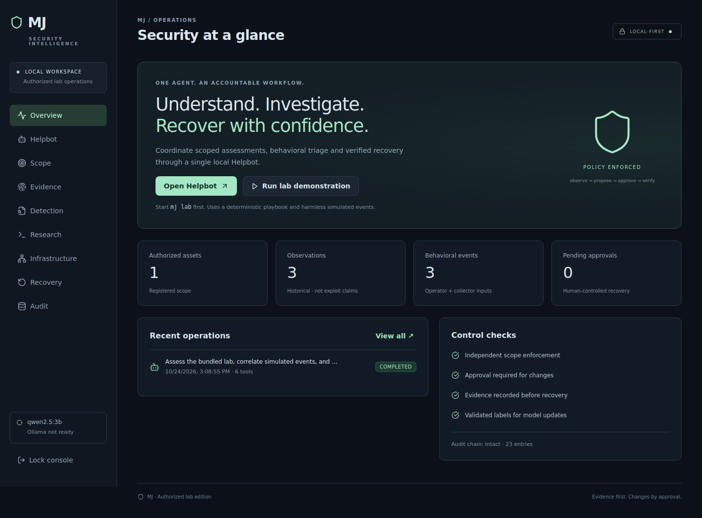

# MJ — Autonomous Security Intelligence for Authorized Labs

**One local Helpbot. Explicit scope. Evidence-backed actions. Human-approved recovery.**

MJ is the final-year project developed in the ARES repository. It combines a local Ollama planner, bounded security tools, behavioral detection, River online learning, reversible lab remediation and a React operations console. No paid AI API is required.

This release is a runnable **lab platform**, not a production EDR, universal pentest agent or autonomous malware detonation service. The feature and validation boundaries below are part of the deliverable, not hidden assumptions.



## Quick start on Kali / Linux

Prerequisites: Python **3.11 or 3.12**, `python3-venv`, Node.js **22**, npm. `gcc` is optional for the native research harness. Install missing packages through your normal system package manager. Run MJ as an ordinary user, not root.

```bash
git clone https://github.com/KIRAN-010/ARES.git
cd ARES
bash scripts/setup.sh
bash scripts/start.sh
```

Open **http://127.0.0.1:8765**. In another terminal, from the repository root:

```bash
.venv/bin/mj token
```

Paste that token into the console. The startup script runs the API/dashboard on port **8765** and the intentionally weak, synthetic demonstration workload on **8091**. The token is generated locally and stored with owner-only permissions in `data/operator-token`. It is never committed.

Click **Run lab demonstration** on Overview. This explicitly registers the bundled loopback lab, inserts clearly marked simulated events and starts the deterministic assessment playbook. You can demonstrate the entire evidence → approval → remediation → verification workflow **without downloading an LLM**.

### Enable local AI planning

Install [Ollama](https://ollama.com/download/linux), start its local service, then:

```bash
ollama pull qwen2.5:3b
```

In Helpbot choose **Local Ollama** and enter an objective. Enable **Allow recovery proposals** if wanted; this never authorizes execution. The selected model must be installed; Ollama failures stop the mission rather than silently switching planners. The model chooses from structured actions after seeing each step's results. It cannot issue shell commands, approve changes, change scope or train the detector. Advanced API clients can further restrict a mission with `allowed_tools`.

For an already installed alternative model, export `MJ_MODEL` before starting MJ. The model needs reliable JSON-schema output. The default is a modest 3B model, not a claim of expert-level reasoning. [Model listing](https://ollama.com/library/qwen2.5:3b) · [Ollama chat API](https://docs.ollama.com/api/chat).

## What is implemented

| Domain | Working implementation | Boundary |
|---|---|---|
| Unified agent | Local Ollama structured planning, iterative tool selection, target-specific operational memory, cancellation, twelve-step budget | One worker; no arbitrary shell or unsupervised scope expansion |
| Web assessment | Bounded HTTP evidence, header observations, body hash, no redirect following | Header gaps are not labeled exploitable vulnerabilities |
| API authorization | Two synthetic identities; legitimate baselines; cross-user record comparison; reproducible broken object-level authorization (BOLA) finding | This validator is restricted to the bundled lab, not arbitrary API schemas |
| Network | TCP connect tests on up to 16 registered ports | No Internet scanning, service exploitation or credential attacks |
| Endpoint | Local process inventory and bounded process-event collector | No kernel sensor, rootkit detection or complete endpoint telemetry |
| Behavioral / malware triage | Auth bursts, temporary executable writes, persistence/encoded-command indicators, correlation; file hashes, entropy and string checks | Suspicious indicators are not conclusive malware verdicts; uploaded files never execute |
| Online learning | River scaler + logistic regression, predict-before-learn metrics, validated labels, replayable model state, duplicate-label prevention, ADWIN drift pause | Experimental detector; no pre-trained real-world accuracy claim |
| Software research | Seeded parser fuzzing, crash reproduction, minimization, fixed-parser validation; native C/ASan harness | Deliberate educational fixtures, not discovered third-party vulnerabilities |
| Infrastructure | Offline Kubernetes manifest checks | No live cloud account access or cluster changes |
| Self-healing | Approval-gated demo configuration fix and restoration; HTTP and authorization regression checks; compensation on failure | No generic patch generation/application |
| VM recovery | VirtualBox UUID allowlist, network disconnect/reconnect, powered-off snapshot restore | Real adapter code; VM calls tested with a fake driver, not a real hypervisor in this build environment |
| Evidence | SQLite state, hash-linked audit, per-job JSON report, historical findings, recovery preconditions | Hash chain is not tamper-proof against the database administrator |
| Dashboard | Scope, Helpbot, evidence, detection, research, infrastructure, recovery and audit screens | Single local operator; not a multi-tenant service |

## Demonstrate a real fix, not just recommendations

1. Start the bundled lab and MJ using `scripts/start.sh`; unlock the dashboard.
2. Run the lab demonstration. Inspect the Helpbot tool timeline.
3. In Evidence, distinguish the two missing-header observations from the **confirmed synthetic cross-user record read**. The authorization test proves Alice can obtain Bob's dummy record and compares it to Bob's valid baseline.
4. In Detection, inspect the explicitly simulated suspicious events. They do not automatically train the model.
5. Open Recovery. Inspect the proposed `lab_harden` precondition, risk and expiry. Enter a decision reason and approve.
6. MJ writes its own lab configuration, verifies headers, verifies both users can still read their own records, and verifies Alice now receives **403** for Bob's record. A failed check restores the prior configuration.
7. Run the assessment again. The new mission should contain no remaining demo findings. Older findings stay in history rather than disappearing from the audit record.
8. Download both evidence reports. To repeat the presentation, explicitly propose and approve `lab_restore`, which reinstates the intentionally weak demonstration configuration.

The lab contains only synthetic records. Do not expose its deliberately weak starting state beyond loopback.

## Hardware planning

These are planning budgets, not measured minimum specifications:

| Machine | Suggested mode |
|---|---|
| 4 GB RAM | Deterministic playbook, dashboard and lab; skip local LLM and nested VMs |
| 8 GB RAM / ordinary multicore CPU | Try the 3B model, one worker and small lab; monitor actual RAM and inference latency |
| 16 GB+ | More room for Ollama and a separate guest; allocate resources explicitly |

GPU acceleration is optional. A CPU-only model can be slow; MJ uses a 120-second inference timeout and 4,096-token context budget. Do not allocate a VM so much RAM that the controller starts swapping heavily.

## Configuration

Export variables in the shell before starting MJ. `.env` files are **not automatically loaded**.

| Variable | Default | Meaning |
|---|---|---|
| `MJ_DATA_DIR` | `./data` | Local state, generated token, demo configuration |
| `MJ_TOKEN` | generated | Optional operator token, at least 24 characters |
| `MJ_MODEL` | `qwen2.5:3b` | Installed Ollama model name |
| `MJ_OLLAMA_URL` | `http://127.0.0.1:11434` | Local HTTP Ollama service only |
| `MJ_PORT` | `8765` | Loopback API/dashboard port |
| `MJ_LAB_PORT` | `8091` | Bundled workload port; Overview's one-click demo assumes 8091 |
| `MJ_ENABLE_VM` | `0` | Explicitly enable the VirtualBox adapter |
| `MJ_VM_ALLOWLIST` | empty | Comma-separated lowercase VirtualBox UUIDs |

For a custom lab port, register it manually in Scope and start a playbook. Always launch from the repository root so the dashboard and data paths are consistent. Run one API process against each data directory.

## Development and validation

```bash
source .venv/bin/activate
pytest --cov=mj --cov-report=term-missing
ruff check mj tests scripts
python scripts/native_fuzz.py
cd frontend
npm run build
```

`requirements.lock` and `frontend/package-lock.json` capture the tested dependency snapshot. The GitHub Actions workflow checks Python 3.11/3.12, the dashboard build and the bundled native harness. See [validation notes](docs/VALIDATION.md) for what was actually run in the development environment.

For backend-only use, install `pip install -e '.[dev]'`, then `mj serve`; the API works without a frontend build. API schemas are available at authenticated `GET /api/openapi`. Every protected request needs `Authorization: Bearer <operator-token>`.

## Project documentation

- [Architecture and data flow](docs/ARCHITECTURE.md)
- [Operator guide and troubleshooting](docs/OPERATIONS.md)
- [VirtualBox lab recovery setup](docs/VIRTUALBOX.md)
- [Demonstration and evaluation plan](docs/DEMO_AND_EVALUATION.md)
- [Research harness and AFL++ workflow](docs/RESEARCH.md)
- [Security model and known limitations](SECURITY.md)
- [Validation record](docs/VALIDATION.md)

The repository contains no credentials, model weights, collected user telemetry or malware samples. Operational data remains in the ignored `data/` directory.
