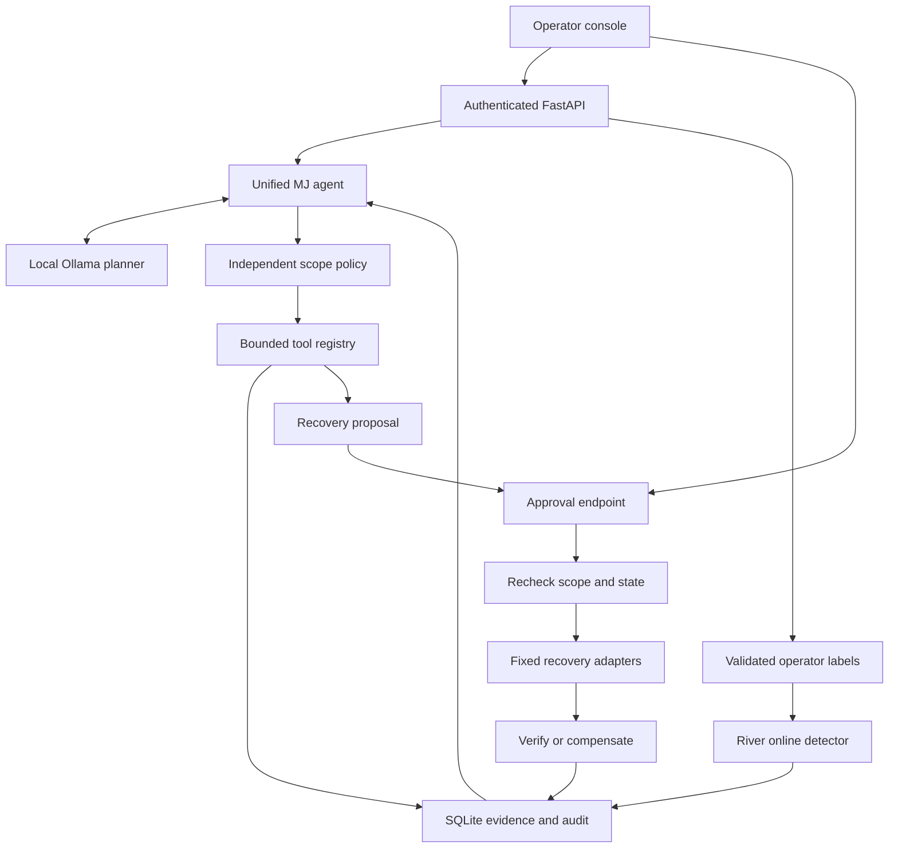

# Architecture

## One intelligence layer, separate enforcement

The Helpbot is the sole planning interface. Its Ollama adapter outputs one strict `Decision` at a time: an enumerated tool name and a reason. The agent supplies the registered target; the model cannot supply arguments, executable paths, commands, credentials or approval decisions. Optional mission-level tool allowlists further narrow the policy-approved set. Recovery proposals require their own per-mission permission, separate from execution approval. Each inference uses a schema narrowed to the remaining allowed tool names.

## Modules

| Module | Responsibility |
|---|---|
| `settings.py`, `schemas.py` | Configuration, strict input types and structured model decisions |
| `policy.py` | IP-literal scope, RFC1918/loopback bounds, control-plane port exclusion, fixed URL paths |
| `store.py` | SQLite transactions, durable JSON objects, chronological hash-linked audit |
| `agent.py` | One-worker queue, iterative planning, tool dispatch, job state, cancellation and restart handling |
| `tools.py` | Web evidence, synthetic authorization validator, TCP probes, local inventory, event correlation and graph |
| `detection.py` | Rule indicators, numerical features, validated online updates and drift tracking |
| `recovery.py` | Human decisions, expiring proposals, preconditions, fixed adapters and verification |
| `research.py` | Bounded mutation/minimization of a built-in parser |
| `infrastructure.py` | Offline Kubernetes checks |
| `lab.py` | Synthetic HTTP/API workload and atomic demonstration configuration |
| `api.py` | Authenticated routes, size caps, local browser boundary and dashboard serving |
| `frontend/` | React + TypeScript operations console |

## Persistence and state machines

The `objects` table holds typed JSON records: target, job, finding, evidence, event, feedback, recovery, sample, research and infrastructure. Record identifiers are server-generated UUID hex values. The `audit` table links each serialized record mutation to the preceding hash. Each object write and its audit entry commit in one SQLite transaction. An in-process reentrant lock serializes writers; the service intentionally runs one process.

Jobs transition through `queued → running → completed / partial / failed / cancelled`. On restart, unfinished jobs become `interrupted`; they never replay automatically. Cancellation occurs at tool boundaries, including a recheck after model inference. It does not kill an in-flight HTTP request or arbitrary process.

Recovery transitions through `pending → rejected / expired / executing → verified / failed`. Restarting an executing recovery marks it `interrupted`, requiring manual inspection. Proposals hold target fingerprint, prior state, action, desired state, expiry, reason and event references. Repeated approvals cannot execute the same proposal twice.

## Evidence semantics

`configuration_observation` records an observed setting and explicitly limits impact. `confirmed_fixture_vulnerability` requires matching legitimate and unauthorized synthetic records. `triage_hypothesis` describes a correlated behavioral pattern without asserting compromise. Graphs preserve that distinction; they are evidence relationships, not proof of a successful multistage attack.

HTTP evidence stores a bounded body hash, status and a small allowlist of headers. It excludes page bodies, Set-Cookie and authorization values. Job reports retain IDs connecting observations, tool execution and recovery. Past findings remain historical after a fix; compare per-job reports to evaluate remediation.

## Three different forms of learning

1. **Operational memory:** previous completed/partial mission objectives and summaries for the same target feed the next planning request.
2. **Model learning:** River `StandardScaler | LogisticRegression` updates only after operator validation. Prediction precedes learning, and the F1/accuracy metrics record that ordering. ADWIN can pause updates following detected drift. Restart reconstructs the model by replaying JSON labels in order, not by loading a pickle.
3. **Planning improvement:** prior outcomes provide context, but there is no trained reinforcement-learning planner or claimed autonomous skill acquisition. Formal strategy optimization is future research.

The detector starts with no training data. It suppresses probabilities until at least 30 labels and five of each class are present. Probabilities remain experimental and do not authorize containment. One label per event, feature bounds and authenticated human provenance reduce some mistakes; they do not make a poisoned or biased dataset trustworthy.

## Extension contract

To add a real-domain tool: define a strict input/output contract; decide which target kind authorizes it; enforce scope in code; bound requests/runtime/output; persist evidence; distinguish observed facts from inferred risk; add failure and authorization tests; only then expose an enum entry to the planner. Do not add a generic shell tool or let model-produced URLs bypass `Policy`.

To add remediation: implement `propose`, precondition capture, fixed execution, evidence preservation, verification and compensation before exposing an operator approval route. Snapshot restore cannot generically undo its own data loss, so its destructive impact must remain explicit.
